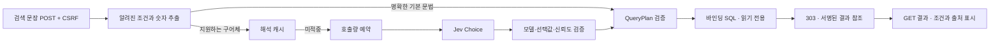

# ADR 002: Ruby 기록 검색과 TypeSafe Jev

2026-10-07. 상태: 로컬 구현·검증, 운영 배포 전.

## 결정

Rails가 입력·카탈로그·숫자와 날짜 후보를 준비하고 Jev의 닫힌 Choice 질문으로 검색 의미를 검증한다. Jev가 SQL·선수 ID·숫자를 생성하게 하지 않는다. 루트 `.env.local`의 `JEV_KEY`를 Ruby 서버가 읽으며 공개 환경변수로 복사하지 않는다. 기존 readonly PostgreSQL과 정규화된 기록 스키마를 그대로 사용한다.

## 의미 보존

- 댈러스 소속 player-game 통계만 대상으로 한다. 비교는 두 선수의 출전당 평균이다.
- 선수·시즌·대회·상대·장소·숫자 비교·집계·정렬·표시 수를 화면에서 확인할 수 있다.
- 알 수 없는 값은 NULL을 유지한다. DNP와 출전을 섞지 않으며 불완전 coverage에서 역사 전체의 공식 기록이라고 단정하지 않는다.
- 달력 연도와 시즌 시작 연도를 구별한다. `2011년 플레이오프`는 2010–11이다. 상대적인 시점은 한국 날짜를 사용한다.
- `21시즌`은 2021–22, `20-21`은 2020–21로 확장한다. 숫자 조건을 시즌으로 바꾸지 않으며 적용 시즌을 화면에 명시한다.
- 정규시즌의 `21년`, `21년도`, `2021년도`도 2021–22로 정규화하고 조사·띄어쓰기 변형을 처리한다. 플레이오프의 연도 표기는 기존 종료 연도 의미를 유지한다. 월·기간·복수 연도 조건은 제거하지 않는다.
- 선수 1명의 지표 미지정 평균(`평균기록`, `average stats`)은 BOX_SCORE 프로필이다. 17개 지표의 전체 출전 경기 평균과 지표별 known/missing, 합계 기반 FG%/3P%/FT%를 반환한다. 단일 집계 SQL이므로 표시 행 제한 50과 평균의 분모는 무관하다. 이 프로필에는 숫자 조건·상위 N·정렬을 적용하지 않고 요청 수정을 안내한다.
- 요청의 일부를 지원하지 못하면 좁은 조건을 제거해 넓은 결과를 반환하지 않는다. 정규화해도 남는 조건, 여러 지표·날짜 범위·포지션 집계는 현재 명시적으로 거절한다.
- 현재 구현은 지원 문법의 구어체를 넓히는 방식이다. 모든 임의 자연어 문장을 이해하는 범용 Text-to-SQL은 아니다.

## 요청·공유·캐시

검색 폼의 POST에서만 외부 해석을 허용한다. 기본 GET 링크는 규칙 또는 검증된 캐시만 사용한다. 해석 캐시는 코드 버전·QueryPlan 버전·모델·release·카탈로그·한국 날짜·질문 해시로 분리한다. 결과 참조는 무작위 ID를 purpose와 만료가 있는 Rails MessageVerifier로 서명한다. GET은 저장된 release의 계획을 다시 검증한 뒤 조회한다. 서명 오류·만료·캐시 유실은 원문을 재해석하는 경로로 연결하지 않는다.

홈과 검색 HTML에는 세션별 CSRF 토큰이 있으므로 `private, no-store`다. 다른 공개 기록 HTML과 읽기 전용 API는 기존 CDN 캐시를 유지한다. 검색 결과는 `noindex, follow`이며 기록·경기 상세가 검색 엔진에 노출되는 구조다.

평균 프로필은 핵심 3개 수치, 보조 기록, 슈팅 3행, 세부 기록으로 나누고 설명은 native details로 접는다. 누락 경고와 모든 20개 값은 보존한다. CSS 내용 SHA-256을 URL에 붙여 이전 스타일 캐시와 분리한다. 한영 HTTP 화면·CSS 구문/해시·142개 테스트(3,368 assertions)를 확인했다. CUA에 브라우저 연결이 없어 실제 뷰포트 시각 검증은 수행하지 못했다.

## 외부 호출 경계

[공식 API](https://docs.typesafe.ai/api)의 `https://api.typesafe.ai/v1/systemone`과 [Choice 형식](https://docs.typesafe.ai/primitives/choice)을 사용한다. 기본 [모델](https://docs.typesafe.ai/models)은 `jev-1.13.0`이다. HTTP 프록시 환경값을 사용하지 않고 TLS 검증, 총 8초 제한, 요청 48KiB·응답 128KiB 제한을 적용한다. 리디렉션과 자동 재시도가 없다. 잘못된 JSON/HTTP 응답과 네트워크 오류는 원문과 exception cause를 제외한 코드로 바꾼다.

SQL·DB 계정·전체 경기 행·회원 정보는 전송하지 않는다. 알려진 선수 공개 정보, 사용자가 입력한 질문과 후보 조건만 전달한다. 민감정보 패턴은 NFKC 정규화 후 검사한다. 패턴 검사는 개인정보 판별을 완전히 보장하지 않으므로 폼에서도 개인정보 입력을 피하도록 안내한다.

사용량 파일은 `0600`, 디렉터리는 `0700`이며 키·원문·IP를 저장하지 않는다. `flock` 아래 요청 수와 요청 바이트 기반 보수적 입력량을 먼저 예약한다. 실패도 예약을 돌려주지 않는다. 기본 일 40회/250,000 예약량, IP 해시별 분당 5회, 동시 2회다. 일일 기준은 UTC다. 이는 자동 결제 한도 설정을 대체하지 않으며 앱에서 자동 충전하지 않는다.

단일 호스트에서 같은 영속 `JEV_BUDGET_PATH`를 공유해야 한다. 파일 삭제·독립 컨테이너 복제는 상한을 초기화하거나 분산시킨다. 다중 호스트로 확장할 때는 이 ledger를 원자적인 공용 저장소로 옮긴다. 현재 로컬/Hostinger 단일 VPS 계획에서는 별도의 Redis나 PostgreSQL 확장이 필요하지 않다.

## 검증

Jev client/budget, 계획 검증, 한영 자연어 골든 케이스, CSRF를 실제 활성화한 POST→303→GET, 변조·만료·캐시 유실, GET 외부 호출 금지, 출처/NULL 및 기존 SEO·데이터 조회 회귀를 테스트한다. 실제 API 확인에는 공개 농구 질문의 소수 표본만 사용한다. 설치·운영 배포·자동 충전은 수행하지 않는다.

완료 결과: Ruby **122 tests / 2,939 assertions**, Zeitwerk autoload 확인, 실서버 **67 HTTP checks / 82 GETs** 모두 통과했다. 별도 HTTP 폼 검증에서 자연어 평균 조회 1회만 API를 호출하고 결과 재조회는 0회, 모호한 연도·복합 조건 입력도 0회임을 확인했다. 실제 Jev 표본은 플레이오프 수치 조건·달력연도 평균·2인 통산 비교를 검증했다. 비교의 ‘통산’ 의미가 처음에는 불확실하게 반환되어 DAL 범위와 생략 필드 의미를 명시했고, 신뢰도 기준을 낮추지 않고 해결했다. 전체 API 인증·해석 확인에서 키 값은 출력하지 않았다.

평균 프로필 후속 검증: **140 tests / 3,233 assertions**와 Zeitwerk 확인을 통과했다. 사용자가 보고한 `21시즌 루카의 평균기록 알려줘. ` 원문으로 POST→303→GET 200, 한영 화면, 추가 API 호출 0회를 확인했다. 실제 복원 데이터에서 2020–21 정규시즌 66경기, 2021–22 정규시즌 65경기, 2021–22 플레이오프 15경기의 17개 평균·3개 성공률·known/missing을 개별 경기 데이터로 다시 계산해 SQL 결과와 비교했다. 모두 일치했다. 없는 시즌은 평균 0 대신 빈 결과로 표시한다.
